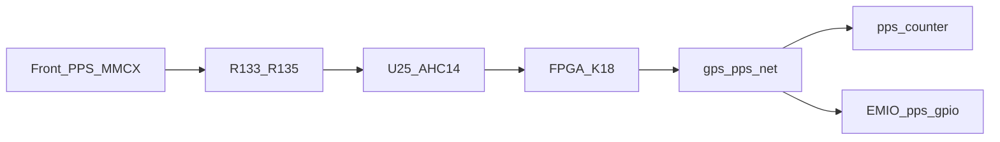

# Windows Vivado: native MMCX PPS bitstream

Agent brief for the Windows PC after Vivado 2022.2 is installed. Goal: produce a LibreSDR bitstream that uses the front-panel PPS MMCX, then hand the `.bit` to Linux for firmware packaging.

## Checklist

- [ ] Edit `boards/libresdr/apply_overlay.py`: `gps_pps` G15/LVCMOS33 → K18/LVCMOS25; update `docs/LIBRESDR.md` wiring table
- [ ] Run `docker-run.sh --target libresdr --prepare-hdl`; verify prepared `system_constr.xdc` has K18 not G15 for `gps_pps`
- [ ] Run `tools/build-libresdr-hdl.ps1` with Vivado 2022.2; produce `output/libresdr-hdl/system_top.bit`
- [ ] Ship `system_top.bit` + SHA256 + git commit to Linux for `docker --prebuilt-bit` packaging

## Goal

Produce `output/libresdr-hdl/system_top.bit` for **LibreSDR / HamGeek XC7Z020** where `gps_pps` is constrained to the **front-panel PPS MMCX path** (`PPS_IN` = **K18**, bank 34, **LVCMOS25**), not CN1 `EXT_GPIO0` (**G15**).

Packaging the rootfs/SD image can happen later on the Linux machine with:

```bash
bash docker-run.sh --target libresdr --prebuilt-bit <path-to>/system_top.bit
```

Do **not** flash QSPI in this Windows phase; SD-only artifacts are the target.

## Context (already proven on hardware)

- Board: LibreSDR Rev.5-class (Z7020/AD9363). Schematic: `zynqsdr_rev5.pdf` (MMCX → R133/R135 → U25 `SN74AHC1G14` → net `PPS_IN` → **K18**).
- Current published image `plutoplus-gps-timing` v2.0.4 listens on **G15** (CN1 pin 1). Front MMCX alone does not tick `/dev/pps0` until remapped.
- Host-centric timing is intended: SDR marks IQ vs PPS; host USB GPS provides NMEA. UART on K14/J14 can remain in the design for later; this task only changes the PPS package pin.



## Prerequisites on the Windows PC

- **Vivado 2022.2** under e.g. `C:\Xilinx` (free WebPACK is enough for xc7z020).
- **Docker Desktop (WSL2 backend)** — required for `docker-run.sh --prepare-hdl`.
- **GNU Make**: Vitis HLS bundled make is fine, e.g.
  `C:\Xilinx\Vitis_HLS\2022.2\tps\win64\msys64\mingw64\bin\make.exe`
  (or Cygwin `make.exe`).
- Git + Git Bash (or WSL) to run `bash docker-run.sh`.
- ~50+ GB free for HDL/Vivado build trees.
- Clone: https://github.com/aaknitt/plutoplus-gps-timing.git (fork of lgarrido581; work from repo root). Check out branch `libresdr-mmcx-pps`.

## Step 1 — Change the PPS pin in the overlay (before prepare-hdl)

Edit `boards/libresdr/apply_overlay.py` so the XDC replacement for `gps_pps` uses **K18 / LVCMOS25**, not G15 / LVCMOS33.

Current snippet (replace this):

```python
"""# LibreSDR GPS header: bank 35 is powered at 3.3 V.
set_property -dict {PACKAGE_PIN G15 IOSTANDARD LVCMOS33 PULLDOWN TRUE} [get_ports gps_pps]
set_property -dict {PACKAGE_PIN K14 IOSTANDARD LVCMOS33} [get_ports gps_uart_rx]
set_property -dict {PACKAGE_PIN J14 IOSTANDARD LVCMOS33} [get_ports gps_uart_tx]
""",
```

New snippet:

```python
"""# LibreSDR front-panel PPS MMCX: net PPS_IN on bank 34 (VCCO=2.5V) pin K18.
# Keep UART on expansion header pins for optional on-SDR NMEA later.
set_property -dict {PACKAGE_PIN K18 IOSTANDARD LVCMOS25 PULLDOWN TRUE} [get_ports gps_pps]
set_property -dict {PACKAGE_PIN K14 IOSTANDARD LVCMOS33} [get_ports gps_uart_rx]
set_property -dict {PACKAGE_PIN J14 IOSTANDARD LVCMOS33} [get_ports gps_uart_tx]
""",
```

Also update the wiring table in `docs/LIBRESDR.md` to document PPS = front MMCX / K18 / LVCMOS25 (so the next human/agent is not misled by the old G15 table).

**Do not** change Pluto+ F20/MIO9 paths; this is LibreSDR-only.

## Step 2 — Prepare HDL tree (Docker)

From repo root in Git Bash/WSL:

```bash
bash docker-run.sh --target libresdr --prepare-hdl
```

This populates `output/libresdr-hdl/` with pinned PlutoSDR v0.38 + LibreSDR patches + this repo’s overlay (including the edited XDC).

**Verify before synth** that the prepared constraint file contains K18:

```powershell
Select-String -Path output\libresdr-hdl\**\system_constr.xdc -Pattern "gps_pps|K18|G15"
```

Expect `PACKAGE_PIN K18` + `LVCMOS25` on `gps_pps`, and **no** `G15` on `gps_pps`. If G15 is still present, the overlay edit was not applied — fix and re-run `--prepare-hdl` (clean `output/libresdr-hdl` if needed).

## Step 3 — Synthesize / implement with Vivado 2022.2

```powershell
.\tools\build-libresdr-hdl.ps1 `
  -VivadoRoot C:\Xilinx `
  -MakeExe C:\Xilinx\Vitis_HLS\2022.2\tps\win64\msys64\mingw64\bin\make.exe
```

Adjust `-VivadoRoot` / `-MakeExe` to the actual install paths.

**Success criteria:**

- Exit code 0
- Artifact exists: `output/libresdr-hdl/system_top.bit` (expect ~2+ MB; reject tiny/truncated files)
- Log: `output/libresdr-hdl/windows-vivado-build.log`
- Timing reports under `output/libresdr-hdl/projects/libre/libre.runs/impl_1/` — do **not** “fix” LVDS hold by enabling global `Performance_Explore`; follow existing project rules in `docs/LIBRESDR.md`

Optional host-side unit check (no Vivado):

```powershell
python hdl/pps_counter/test_tdd_window_model.py
```

## Step 4 — Deliverable / handoff (stop here on Windows)

Copy to the Linux packaging machine:

1. `output/libresdr-hdl/system_top.bit`
2. SHA256 of that file
3. Note of Vivado version + git commit hash of the plutoplus-gps-timing tree used
4. Confirmation that prepared `system_constr.xdc` showed K18/LVCMOS25

Linux follow-up (out of scope for the Windows agent, but the contract is):

```bash
bash docker-run.sh --target libresdr --prebuilt-bit /path/to/system_top.bit
# then finalize BOOT.bin / SD as already done for v2.0.4 bring-up
```

## Hardware validation notes (for whoever flashes the SD)

- Prefer SD boot; keep a known-good card for recovery.
- Front **PPS MMCX** → GPS 1PPS; common ground.
- Weak ~2.3 V GPS PPS may still fail the **U25** Schmitt path because of **R133/R135**. If MMCX center toggles but `/dev/pps0` does not, short/replace **R133 with 0 Ω** (lab mod), then retest — same issue seen before CN1 bypass.
- Pass criteria on device: `/sys/class/pps/pps0/assert` count climbs; `devmem 0x7C460008 32` → `0x1`; `devmem 0x7C460018 32` (`PPS_SEQ`) increments ~1 Hz; RX `cf-ad9361-lpc` still probes; gated `pluto_ctld` capture still works over USB gadget/Ethernet.

## Failure / recovery tips for the Windows agent

- Docker not running → start Docker Desktop; retry `--prepare-hdl`.
- `make` not found → pass a real `-MakeExe` path from Vitis HLS or Cygwin.
- Vivado license / device not installed → install xc7z020 support in Vivado 2022.2.
- Prepare-hdl stale → delete `output/libresdr-hdl` and re-run after the overlay edit.
- Build OOM → close other apps; Vivado for this design wants a roomy machine (16 GB+ RAM preferred).
